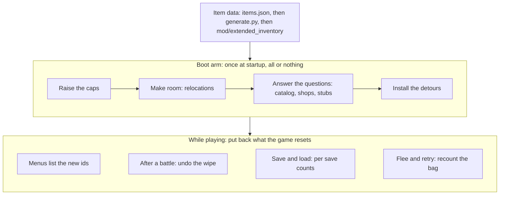

# Extended/

The game's item tables stop at 261. These files add items past that. Four moves do it. The checks that say "is the number under 261" get raised. The tables that need room for new rows get copied into space we own, and the game is pointed at the copy. Everything else the game asks about an item, stats, range, art, category, gets answered by our own code for the new ids and passed through untouched for the old ones. And whenever the game rebuilds its own state from base game data (after a battle, on a load, on a flee or a Retry), which forgets the new items, a hook puts them back.

## At a glance

## How it works

Think of the game as a clerk asking questions about any item it meets. What kind of thing are you, what are your stats, is your number under 261. For most of those questions the clerk never looks anything up itself. It jumps to a small lookup routine and takes whatever answer comes back. We aim those jumps at our own code, which answers for the new items and hands everything else straight to the original. The new item never has to be in the game's own tables for those questions.

A few things the game does look up directly, the item catalog and the menu order tables. Those get copied into a roomier page of ours with the new rows added, and the reads are re-pointed at the copy.

The list of checks was found one refusal at a time. The history is in docs/research/ITEM_CAP_261_BREAK_JOURNEY.md.

## All or nothing

Everything installs once, at boot, as one transaction. Before any spot in the game's code is changed, the bytes there are read and compared with what we expect. If even one spot reads wrong, because a game update shifted it or another mod got there first, every step already done is undone in reverse and the game runs without the extra items. Delete the mod and a save holding an extra item loads with that hand empty and the item gone (docs/LIVE_LEDGER.md, capbreak-uninstall-is-clean-loss). The sidecar json is left behind in the mod's user folder. Only this mod ever reads it.

## The questions and who answers them

| The game asks | Answered in |
|---|---|
| What kind of item is 262? Its price, its category, its icon? | ExtendedCatalog.cs, ExtendedRecords.cs, TemplateRelocation*.cs |
| What are its stats, its range, its artwork? | AccessorEntryHook.cs, ThunkStub*.cs, ExtendedDonorThunks.cs |
| Is its number under 261? | BytePatchSet.cs, ExtendedSites.cs, ListRelocation*.cs |
| Why is it not in this menu? | ListBuilderHook*.cs, OrderRebuildHook*.cs, CategoryGetterHook.cs, ShopFlagsMirror.cs |
| How many are in the bag? (the save has no slot for a new item) | ../Persistence/ExtendedBagSidecar.cs, SaveEdgeHooks*.cs, SaveEdgeTracker.cs |
| The game just reset the bag. Where did the new items go? | InventoryResetHook.cs (after a battle), RewindRestoreHook*.cs, RewindTotals*.cs, RewindRecomputeStep.cs (after a flee or a Retry) |
| What is it called and what does it look like? | item.en.nxd rows and the shipped .tex files, built by the pipeline, not here |

The rest is plumbing. ExtendedInventory.cs and its three partials hold the state, the install order (ExtendedInventory.Arm.cs), the hooks and the undo (ExtendedInventory.Hooks.cs), and the per tick work in ExtendedInventory.Tick.cs. That work includes writing each save's counts to the sidecar, putting the bag counts back after every load (and seating the menu charts when the load detour missed it), refreshing the shop mirror, the rewind recount, any cap patch that has to wait until after a load (none on today's game build), and a tripwire that warns if something still writes the original tables the game was moved off. ExtendedInventoryData.cs loads the shipped item tables from the mod folder. SwingIdFallbackHook.cs makes a new item swing like a real weapon instead of a bare fist. TemplateSync.cs keeps the copied order templates in step with the originals.

## Install order

The steps lean on each other, so the order is fixed. Cap patches, list relocation, template relocation, catalog, shops, accessor hooks, swing fix, then the detours. It is all in ExtendedInventory.Arm.cs. The first step that refuses stops the run and RollBack in ExtendedInventory.Hooks.cs undoes the earlier steps in reverse.

## Words that show up a lot

- **site**. One exact spot in the game's code that we change.
- **cap**. A check that an item's number is under 261. Widening it means raising that number so the new items pass.
- **donor**. Two per item. The clone donor supplies behavior, the art donor supplies the sprite and icon. Only the stat row is the new item's own.
- **accessor**. One of the small game routines that answers a single question about an item. On today's game build we put a jump at the start of each one into our own code, which answers for new items and passes everything else through. On the old copy protected build that jump already existed, a **thunk**, which is why the name still shows up.
- **stub** and **trampoline**. The stub is our replacement code for one accessor. The trampoline replays the few original instructions our jump covered, then continues into the game's routine. Both are hand written machine code, because an ordinary hook crashed the game here. Our own stub code touches only rax and rcx. The trampoline runs the game's own first instructions again, so it touches whatever those touch.
- **detour**. An ordinary hook through Reloaded.Hooks: our code runs around one of the game's routines. Used everywhere the hand written stubs are not needed.
- **prologue** or **landmark**. The first bytes of a game routine. Every hook checks them before installing, so a game update makes the mod refuse instead of crash.
- **page**. Memory this mod owns. A page is never freed ("leaked") on undo, because a game thread may still be running inside it.
- **save edge** and **save key**. The moment of a save or a load, and the fingerprint that names one save so its counts go back to the right file.
- **rewind**. A flee or a Retry. Both restore a copy of the party taken before the battle, and that copy only knows the base game's items.
- **template**, also called an order template or an order chart. One of the game's lists that decides which items appear in a menu and in what order. The code calls them charts.
- **relocation**. Copying one of the game's tables into roomier space of ours and pointing the game at the copy.
- **sidecar**. extended_inventory.json in the mod's user folder, next to kills.json. The game save has no byte for a new item's bag count, so the count lives there and is put back when the save loads.

## Where to start

ExtendedRecords.cs first. It is only the record layout, no memory access. Then ExtendedInventory.Arm.cs for how the parts fit. After that pick one row of the table and follow it. A good first thread is how a new weapon reaches the Weapons tab: ExtendedCatalog.cs, then CategoryGetterHook.cs, OrderRebuildHook.cs and ListBuilderHook.cs. InventoryResetHook.cs is the clearest example of the put it back pattern: save the bytes, let the game run, write them back.

The machine code layer (ThunkStub*.cs, AccessorEntryHook.cs, SwingIdFallbackHook.cs) can be read last or not at all. Its job is to answer the game's item questions for a new id, mostly as the donor item, with the weapon stat row as the new item's own. SwingIdFallbackHook.cs is the one exception. It fixes the swing so a new weapon is not drawn as a bare fist.

Every .cs file in this folder must be named in this README, as itself or through a pattern like ListRelocation*.cs. ExtendedReadmeContractTests fails the build when one is missing, so a new file needs a line here.

The byte layouts and sites were read from the 1.5.2 exe (now the copy protection free build, which loads at a random base, so every address is an offset from ImageBase) and are pinned by the Extended*Tests in LivingWeapon.Tests. The sites live in ExtendedSites.cs, the *.Sites.cs partials and Offsets.cs, each with the date and the probe or offline read it came from. After a game patch, follow docs/PATCH_REANCHOR.md.
